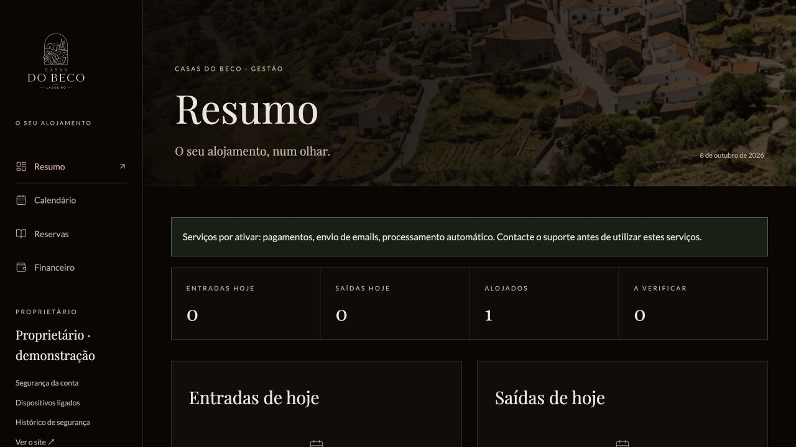

> Registo histórico anterior à transição de 14/10/2026. A arquitetura e os comandos atuais estão no README e no relatório dessa transição. Os resultados abaixo referem-se à implementação que existia nessa data.

# Verificação do admin do proprietário

Data: 08/10/2026. Branch: a branch de trabalho anterior. Alterações locais, sem commit/push/deploy nesta entrega. O repositório já continha trabalho não commitado; foi preservado. Não foi feita nova comparação com GitHub nesta revisão.

## Resultado

Admin reconstruído no tema do site público, com Resumo/Calendário/Reservas/Financeiro. Configuração estrutural retirada do painel e endpoint antigo desativado. Motor, autenticação, inventário e histórico preservados. Operações/filas/reconciliação implementadas; não afirmar prontidão de produção sem serviços e ensaios reais.

## Verificações executadas

| Verificação | Resultado |
|---|---|
| `npm run lint` | Passou (TypeScript sem emissão). |
| `npm run test:contact` | 3 testes passaram. |
| `npm run test:admin` | 17 testes passaram: configuração técnica/validação, segurança/histórico/sessões e recuperação por email simulado. |
| `npm run test:pms` | 12 testes passaram: preços, capacidade, inventário, checkout, retry, assinatura, webhooks fora de ordem, reembolsos e corpos HTTP. |
| `npm run test:owner` | 18 testes passaram: operação diária, rollback, revisão, montantes, bloqueios, filtros, emails, fornecedor simulado, recuperação/retry de checkout e retorno do pagamento de saldo. |
| `npm run test:admin:postgres` | 1 teste integrado passou: auth real Better Auth + MFA, rotação/revogação/recovery/rate limits, API owner autenticada, anónimo/Origin externo recusados e configuração 410. Schema fictício apagado no finally. |
| `npm run test:pms:postgres` | 1 teste passou: duas reservas concorrentes, uma única ocupa o quarto. Só fixtures de teste; removidas no finally. |
| `npm run test:owner:postgres` | 1 teste passou: mesma operação concorrente cria apenas uma reserva/email; operações concorrentes distintas não sobrepõem noites. Schema descartável apagado. |
| Compilação framework anterior | Passou após as alterações finais; páginas públicas geradas, backend Node incluído. Cache de build separada do preview. |
| `tests/http-smoke.mjs` | Passou no preview e na compilação de produção local: dez páginas/assets, 404, cotação, datas inválidas, webhook sem assinatura, estado inválido, checkout desativado, contacto inválido, redirects/MFA/API anónima/Origin e tombstone 410. |
| `git diff --check` | Sem problemas de whitespace. |
| Auditoria de dependências | Dois avisos high corrigidos com sharp 0.35.5 e source-map-js 1.2.2; `npm audit` após atualização reportou zero vulnerabilidades conhecidas. Animações mantêm framer-motion 12.43.0, agora dependência direta. |
| Worker | Um ciclo executado em schema isolado, com SMTP/Stripe obrigatoriamente vazios; nenhuma comunicação ou transação externa. |

Total das suítes: **53 testes**, além de smoke HTTP, compilação e verificação visual. Algumas verificações foram repetidas apenas após alterações/falhas relacionadas. Falhas iniciais de fixtures/tipagem/JSX foram corrigidas antes dos resultados finais; não escondidas como testes aprovados.

## Verificação pela interface

Conta e hóspedes totalmente fictícios num schema PostgreSQL separado e preview separado, sem usar a palavra-passe/MFA reais. Testado:

- Navegação resumo/calendário/lista/financeiro e abertura de ficha pelo calendário.
- Criação de reserva manual após consulta de preço/disponibilidade e confirmação: 190 € acordados, 0 € recebidos, 190 € por receber. Noites ficaram no calendário; email apenas em fila de teste.
- Gravação de nota, feedback e reabertura da ficha comprovaram persistência.
- Listagem sem filtro mostrou reservas futuras, incluindo a reserva manual.
- Financeiro mostrou movimentos e comissão desconhecida como não disponível, sem inventar fatura/transferência.
- Telemóvel 390×844: largura do documento 390px; agenda diária visível; grelha mensal desloca-se só no seu contentor.
- Desktop 1280×720: identidade escura, Playfair/Lato, logótipo/imagem do site e navegação consistente.
- «Ver o site» abriu e renderizou os conteúdos públicos. Não houve redesenho dos componentes/animações públicas nesta revisão; isto não é uma comparação pixel a pixel de todas as animações.

O schema/conta/fixtures e ficheiros de credenciais de teste foram removidos. Servidores temporários encerrados. Preview do projeto mantido em `http://127.0.0.1:3004/admin` (login normal obrigatório); nenhuma sessão de teste ficou no projeto real.

## Base e migrações

Base local tinha versões 1–8 aplicadas. Novas 009/010 aplicadas sem reutilizar 007/008 ou apagar tabelas/histórico legados. Conta real e seu segundo fator não foram alterados. Bases novas/testes aplicam os ficheiros 001–006/009/010 existentes. A ausência dos antigos ficheiros 007/008 e os dados sem consumidores estão descritos no mapa; não executar DROP por suposição.

## Antes de publicar

1. Ensaiar Stripe de teste real: cartão/MB WAY, total/sinal/saldo, refund parcial/completo/falhado, resposta perdida e reinício, webhooks e reconciliação.
2. Configurar SMTP e validar entrega e recuperação real, com envio autorizado.
3. Definir condições/regras/preços/inventário finais e processo fiscal/SIBA aplicável; o sistema não emite faturas certificadas.
4. Alojamento HTTPS, supervisão web/worker, monitorização/alertas e backup/restauro testado; validar identidade de IP/proxy e rate limits no alojamento.
5. Política de retenção/eliminação de dados, revisão pública PT/EN e seletor público crianças/bebés. Não ativar reservas reais apenas porque testes locais passaram.

Detalhe de âmbito e capacidades ainda não implementadas: [Plano ativo](pms/PLANO-ADMIN-PROPRIETARIO.md). Código retirado, falhas corrigidas e limites da análise: [Mapa de código e segurança](pms/MAPA-CODIGO-SEGURANCA.md).
